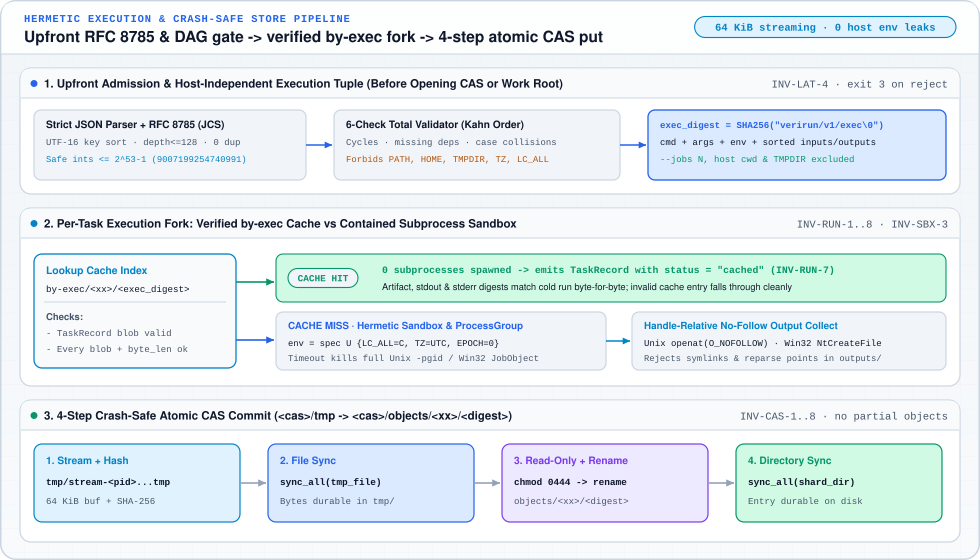

<div align="center">
  <picture>
    <source media="(prefers-color-scheme: dark)" srcset="https://raw.githubusercontent.com/david-engelmann/verirun/main/docs/media/verirun-lockup-dark.svg">
    
  </picture>
  <p><strong>Hermetic task-DAG runner, crash-safe SHA-256 content-addressed store, and RFC 8785 Merkle manifest verifier.</strong></p>
  <p>
    <a href="https://github.com/david-engelmann/verirun/actions/workflows/ci.yml"></a>
    <a href="https://crates.io/crates/verirun-cli"></a>
    <a href="https://crates.io/crates/verirun-core"></a>
    <a href="https://pypi.org/project/verirun/"></a>
    <a href="https://docs.rs/verirun-core"></a>
    <a href="https://github.com/david-engelmann/verirun/blob/main/LICENSE-MIT"></a>
  </p>
  <p>
    <a href="https://david-engelmann.github.io/verirun/">Documentation Book</a> ·
    <a href="https://github.com/david-engelmann/verirun/blob/main/docs/TUTORIAL.md">Tutorial</a> ·
    <a href="https://github.com/david-engelmann/verirun/blob/main/docs/ARCHITECTURE.md">Architecture</a> ·
    <a href="https://github.com/david-engelmann/verirun/blob/main/docs/INVARIANTS.md">Invariants</a> ·
    <a href="https://github.com/david-engelmann/verirun/blob/main/docs/COMPARISON.md">Comparison</a> ·
    <a href="https://github.com/david-engelmann/verirun/tree/main/examples">Examples</a>
  </p>
</div>

<p align="center">
  
</p>

`verirun` executes finite directed acyclic graphs (DAGs) of subprocess tasks and produces a portable cryptographic record of what ran and what bytes came out. Given the same JSON spec, input bytes, and deterministic task behavior, `verirun` produces the exact same RFC 8785 (JCS) canonical manifest digest from any host path and at any `--jobs` worker count (`INV-MAN-1`).

---

## Define, Run, and Verify a Pipeline

Install the precompiled CLI or the zero-dependency Python 3.10+ SDK:

```sh
# Prebuilt Linux / macOS tarball verified against SHA256SUMS
curl -fsSL https://raw.githubusercontent.com/david-engelmann/verirun/main/install.sh | sh

# Python 3.10+ wheel (bundles native verirun binary + PipelineBuilder SDK)
pip install verirun

# Cargo / cargo-binstall
cargo install verirun-cli
```

Build and verify a two-stage pipeline in Python (or pass an equivalent `run.json` directly to `verirun run`):

```python
from pathlib import Path
import verirun

pipeline = (
    verirun.PipelineBuilder()
    .add_task(
        task_id="greet",
        executable="sh",
        args=["-c", "printf 'hello world\\n' > outputs/greeting.txt"],
        outputs=["greeting.txt"],
    )
    .add_task(
        task_id="shout",
        executable="sh",
        args=["-c", "tr 'a-z' 'A-Z' < inputs/greeting.txt > outputs/loud.txt"],
        inputs=["greeting.txt"],
        outputs=["loud.txt"],
        depends_on=["greet"],
    )
)

pipeline.validate()  # Kahn topological + path checks before touching the filesystem
run_res = pipeline.run(cas=Path("./cas"), work=Path("./work"), jobs=4, pin_manifest=True)
check = verirun.verify(run_res.manifest, cas=Path("./cas"))
assert check.verified
```

Or drive the lifecycle from the shell with total exit-code separation (`INV-CLI-1`):

```sh
verirun run run.json --cas ./cas --work ./work --jobs 4 --pin --json
verirun verify <manifest_digest> --cas ./cas --json
verirun show   <manifest_digest> --cas ./cas --json
verirun diff   <manifest_a> <manifest_b> --cas ./cas --json
verirun gc     --cas ./cas --grace-secs 3600 --dry-run --json
```

| Exit code | Meaning | Raised when |
| --- | --- | --- |
| `0` | Success / verified / equivalent | All tasks succeeded or hit verified cache, `verify` passed every hash check, or `diff` found zero record differences. |
| `1` | Task failure or manifest diff | A task exited nonzero, timed out (`TimedOut`), was skipped after an upstream failure (`Skipped`), or `diff` found changed records. |
| `2` | Cryptographic / store integrity failure | Manifest blob mismatch, non-canonical JSON bytes, Merkle root mismatch, missing object, blob hash mismatch, or artifact byte-length mismatch. |
| `3` | Invalid input, spec, or setup | CLI usage error (overriding clap's default `2`), JSON syntax or `> 2^53 - 1` number error, DAG cycle, colliding output path, reserved `env` key, or cross-device `tmp/`. |

---

## Execution & Crash-Safe Store Pipeline

<p align="center">
  <picture>
    <source media="(prefers-color-scheme: dark)" srcset="https://raw.githubusercontent.com/david-engelmann/verirun/main/docs/media/execution-cas-pipeline-dark.svg">
    
  </picture>
</p>

1. **Upfront spec validation before side effects (`INV-LAT-4`).** `verirun-core` parses `run.json` with a strict recursive-descent parser (rejecting duplicate keys, depth `> 128`, lone surrogates, and integral values outside IEEE-754 safe integers `[-9007199254740991, 9007199254740991]`), checks normalized and case-folded path collisions, rejects reserved `env` keys (`PATH`, `HOME`, `TMPDIR`, `TZ`, `LC_ALL`, `SOURCE_DATE_EPOCH`), and runs Kahn cycle detection before opening `--cas` or `--work`.
2. **Verified `by-exec` cache lookup (`INV-RUN-7`).** Each task's `exec_digest` commits to its executable, ordered args, canonical environment, and sorted input digests and output paths, excluding `--jobs`, host working directory, and temporary directory paths. Before serving a hit from `by-exec/<xx>/<exec_digest>`, `verirun` verifies that every referenced artifact and stream object exists on disk and matches its recorded byte length. Cached runs record `status: "cached"` rather than `"succeeded"` while preserving identical artifact and log digests.
3. **Scrubbed environment, process-tree containment, and no-follow output collection.** Cache misses execute in an isolated task directory with an empty environment populated only with declared `env` pairs plus `LC_ALL=C`, `TZ=UTC`, `SOURCE_DATE_EPOCH=0`, and a private `TMPDIR`. Timeouts kill the entire Unix process group (`SIGKILL` on `-pgid`) or Windows Job Object (`JOB_OBJECT_LIMIT_KILL_ON_JOB_CLOSE`, `INV-RUN-4`). Declared outputs are collected component by component relative to open directory handles (`openat` with `O_NOFOLLOW` on Unix, `NtCreateFile` reparse-point rejection on Windows, `INV-SBX-3`).
4. **4-step crash-safe atomic CAS put (`INV-CAS-1..8`).** Every input, output, `stdout`, `stderr`, and manifest streams in `64 KiB` chunks into `<cas>/tmp/`, calls `sync_all`, sets read-only permissions (`0o444`), atomically renames into `objects/<xx>/<digest>`, and syncs the destination shard directory.

---

## Domain-Separated Hashing & Merkle Tamper Conviction

<p align="center">
  <picture>
    <source media="(prefers-color-scheme: dark)" srcset="https://raw.githubusercontent.com/david-engelmann/verirun/main/docs/media/merkle-domain-tree-dark.svg">
    
  </picture>
</p>

Every SHA-256 digest in `verirun` writes an ASCII domain tag followed by `0x00` before any payload bytes (`Pattern S` for raw byte streams; `Pattern T` with little-endian `u64` length prefixes for structured tuples):

| Domain tag | Framing | Committed payload |
| --- | --- | --- |
| `verirun/v1/blob` | Pattern S | Raw bytes of inputs, outputs, `stdout`, `stderr`, and canonical manifest JSON (deduplicated across roles). |
| `verirun/v1/input` | Pattern T | Normalized relative input path + 32-byte `blob` digest. |
| `verirun/v1/env` | Pattern T | Sorted `(key, value)` count and pairs for the effective task environment (excluding host `TMPDIR`). |
| `verirun/v1/exec` | Pattern T | `executable`, `args`, `env` digest, sorted `input` digests, and sorted declared `output` paths. |
| `verirun/v1/artifact` | Pattern T | Relative path, `blob` digest, `byte_len: u64`, and `is_executable: bool`. |
| `verirun/v1/task` | Pattern T | `task_id`, `exec` digest, status byte (`0..=4`), optional `exit_code: i32`, `stdout`/`stderr` digests, and `artifact` digests. |
| `verirun/v1/node` | Pattern T | `left_digest (32B) || right_digest (32B)` for binary Merkle interior nodes. |
| `verirun/v1/empty` | Pattern S | Empty payload used as the `merkle_root` of a zero-task manifest. |

`verirun verify <manifest_digest>` re-hashes the manifest blob, parses and re-encodes its RFC 8785 bytes, recomputes every `verirun/v1/task` leaf and `verirun/v1/node` root, and streams every distinct referenced blob to check both its SHA-256 digest and recorded `byte_len` (`INV-MAN-3..5`).

---

## Throughput Baselines & Workspace Layout

Recorded on release builds (`rustc 1.88.0`, Linux x86_64 CI runner; reproduce via `cargo bench --workspace`):

| Workload | Benchmark | Throughput |
| --- | --- | --- |
| RFC 8785 canonical JSON encoding | `crates/verirun-core/benches/canonical.rs` | ~112 MiB/s |
| Framed SHA-256 streaming (`64 KiB` chunks) | `crates/verirun-store/benches/store.rs` | ~2,320 MiB/s |
| Atomic CAS `put_known` (write + `fsync` + rename + dir sync) | `crates/verirun-store/benches/store.rs` | ~216 MiB/s |
| Verified CAS `read_verified` (stream + re-hash) | `crates/verirun-store/benches/store.rs` | ~672 MiB/s |

| Crate | External runtime deps | Responsibility |
| --- | --- | --- |
| [`verirun-core`](https://github.com/david-engelmann/verirun/blob/main/crates/verirun-core/README.md) | None (`std` only, `#![forbid(unsafe_code)]`) | Strict JSON parser, RFC 8785 encoder, domain-separated digest framing, Kahn DAG validator, and Merkle manifest model. |
| [`verirun-platform`](https://github.com/david-engelmann/verirun/blob/main/crates/verirun-platform/README.md) | `libc` (Unix), `windows-sys` (Windows) | Narrow OS FFI boundary for `ProcessGroup` / Job Objects, no-follow `DirHandle`, and atomic `rename_replace`. |
| [`verirun-store`](https://github.com/david-engelmann/verirun/blob/main/crates/verirun-store/README.md) | `sha2` | Sharded filesystem CAS, hermetic subprocess runner, deterministic Kahn worker pool, `by-exec` cache, and `gc`. |
| [`verirun-cli`](https://github.com/david-engelmann/verirun/blob/main/crates/verirun-cli/README.md) | `clap`, `serde_json` | `verirun` binary and pipeline API (`run`, `verify`, `show`, `diff`, `pin`, `unpin`, `gc`, `completions`). |

- **Specifications & Walkthroughs:** [Published Documentation Book](https://david-engelmann.github.io/verirun/) · [`docs/TUTORIAL.md`](https://github.com/david-engelmann/verirun/blob/main/docs/TUTORIAL.md) · [`docs/ARCHITECTURE.md`](https://github.com/david-engelmann/verirun/blob/main/docs/ARCHITECTURE.md) · [`docs/INVARIANTS.md`](https://github.com/david-engelmann/verirun/blob/main/docs/INVARIANTS.md)
- **Comparisons, Examples & Governance:** [`docs/COMPARISON.md`](https://github.com/david-engelmann/verirun/blob/main/docs/COMPARISON.md) · [`docs/FAQ.md`](https://github.com/david-engelmann/verirun/blob/main/docs/FAQ.md) · [`examples/`](https://github.com/david-engelmann/verirun/tree/main/examples) · [`fuzz/`](https://github.com/david-engelmann/verirun/tree/main/fuzz) · [`AGENTS.md`](https://github.com/david-engelmann/verirun/blob/main/AGENTS.md) · [`SECURITY.md`](https://github.com/david-engelmann/verirun/blob/main/SECURITY.md)

## License

Licensed under either of [Apache License, Version 2.0](https://github.com/david-engelmann/verirun/blob/main/LICENSE-APACHE) or [MIT License](https://github.com/david-engelmann/verirun/blob/main/LICENSE-MIT), at your option.
