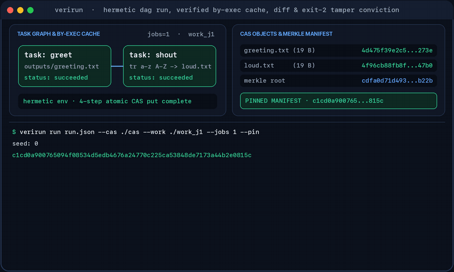
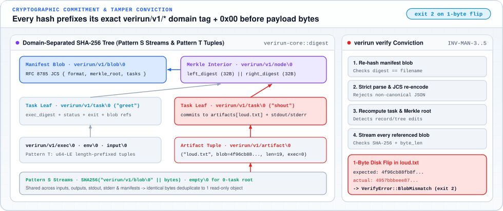
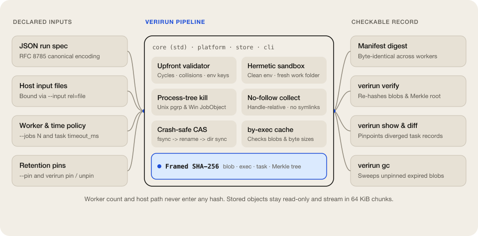

<p align="center">
  <a href="https://github.com/david-engelmann/verirun">
    <picture>
      <source media="(prefers-color-scheme: dark)" srcset="https://raw.githubusercontent.com/david-engelmann/verirun/main/docs/media/verirun-lockup-dark.svg">
      
    </picture>
  </a>
</p>

<h3 align="center">Deterministic task runner and content-addressed build store with cryptographic Merkle manifests.</h3>

<p align="center">
  You describe a batch of shell tasks once as JSON data. <code>verirun</code> validates the graph before executing a single command, runs each task inside a cleaned sandbox, stores every input, output, and output stream by its SHA-256 content digest, and seals the run with a canonical RFC 8785 manifest and Merkle root.
</p>

<p align="center">
  <a href="https://github.com/david-engelmann/verirun/blob/main/docs/TUTORIAL.md"><b>Tutorial</b></a> ·
  <a href="https://github.com/david-engelmann/verirun/blob/main/docs/README.md">Docs</a> ·
  <a href="https://github.com/david-engelmann/verirun/blob/main/docs/ARCHITECTURE.md">Architecture</a> ·
  <a href="https://github.com/david-engelmann/verirun/blob/main/docs/INVARIANTS.md">Invariants</a> ·
  <a href="https://github.com/david-engelmann/verirun/releases">Releases</a>
</p>

<p align="center">
  <a href="https://github.com/david-engelmann/verirun/actions/workflows/ci.yml?query=branch%3Amain"></a>
  <a href="https://crates.io/crates/verirun-cli"></a>
  <a href="https://pypi.org/project/verirun/"></a>
  <a href="https://docs.rs/verirun-core"></a>
  <a href="https://github.com/david-engelmann/verirun/blob/main/Cargo.toml"></a>
  <a href="https://github.com/david-engelmann/verirun/blob/main/LICENSE-MIT"></a>
</p>

<p align="center">
  
</p>

<p align="center"><sub>Every terminal line above comes from real invocations of the <code>verirun</code> release binary against a live content-addressed store.</sub></p>

## Why verirun

Build scripts and pipeline steps usually leave behind mutable folders, ambient environment leaks, and unverified caches. When an artifact changes weeks later, nothing proves whether an input drifted, a cache entry rotted on disk, or worker scheduling changed the order of writes. `verirun` turns every batch run into an immutable, re-verifiable cryptographic record.

- **Upfront graph validation.** Missing dependencies, cycles, duplicate task IDs, colliding output paths, reserved environment keys (`PATH`, `HOME`, `TMPDIR`), and unsafe relative paths are rejected with exit code `3` before any subprocess spawns.
- **Hermetic task sandboxes.** Each task executes in a fresh working folder with a scrubbed environment holding only its declared variables plus fixed deterministic defaults. Worker count (`--jobs`) and host folder paths never enter any digest.
- **Process-tree containment.** Tasks exceeding `timeout_ms` are terminated along with every child in their Unix process group or Windows Job Object, and surviving background group members are cleaned up when the task finishes.
- **Race-free, crash-safe content store.** Outputs are collected component by component relative to open directory handles so symlinks and reparse points are refused without `TOCTOU` races. Blobs land via temporary write, `fsync`, atomic rename, and directory sync, and remain read-only on disk in bounded `64 KiB` streaming chunks.
- **Verified `by-exec` caching.** When a task's executable, arguments, environment, and input digests match a prior success, `verirun` verifies every referenced blob and recorded byte length before reusing the cached record without spawning the program.
- **End-to-end tamper conviction.** `verirun verify` re-parses the canonical manifest, checks the Merkle root, and streams every referenced artifact and log through SHA-256, exiting with code `2` on the first corrupted byte or mismatched size.

<p align="center">
  <picture>
    <source media="(prefers-color-scheme: dark)" srcset="https://raw.githubusercontent.com/david-engelmann/verirun/main/docs/media/tamper-proof-dark.svg">
    
  </picture>
</p>

## How it works

<p align="center">
  <picture>
    <source media="(prefers-color-scheme: dark)" srcset="https://raw.githubusercontent.com/david-engelmann/verirun/main/docs/media/how-it-works-dark.svg">
    
  </picture>
</p>

| Crate | Kind | External runtime deps | Role |
| --- | --- | --- | --- |
| [`verirun-core`](https://github.com/david-engelmann/verirun/blob/main/crates/verirun-core/README.md) | library | none (`std` only) | Strict JSON parser, RFC 8785 canonical encoder, domain-framed digests, DAG validator, and manifest builder and differ. |
| [`verirun-platform`](https://github.com/david-engelmann/verirun/blob/main/crates/verirun-platform/README.md) | library | `libc` (Unix), `windows-sys` (Win) | Sole OS FFI seam for process groups and Job Objects, no-follow handle-relative path traversal, and `rename_replace` atomic replacement. |
| [`verirun-store`](https://github.com/david-engelmann/verirun/blob/main/crates/verirun-store/README.md) | library | `sha2` | Crash-safe sharded content-addressed store, hermetic subprocess runner, parallel scheduler, `by-exec` cache, and garbage collector. |
| [`verirun-cli`](https://github.com/david-engelmann/verirun/blob/main/crates/verirun-cli/README.md) | library and binary (`verirun`) | `clap`, `serde_json` | Command line interface (`run`, `verify`, `show`, `diff`, `pin`, `unpin`, `gc`) with total `--json` parity and documented exit codes. |

## Quickstart

Install the `verirun` binary from PyPI, from crates.io, with `cargo-binstall`, or from the prebuilt Linux, macOS, and Windows archives on GitHub Releases.

```sh
pip install verirun
# or run directly without installing
uvx verirun --version
# or install from crates.io
cargo install verirun-cli
```

```python
import verirun

pipeline = (
    verirun.PipelineBuilder()
    .add_task(
        task_id="greet",
        executable="sh",
        args=["-c", "printf 'hello from verirun\\n' > outputs/greeting.txt"],
        outputs=["greeting.txt"],
    )
    .add_task(
        task_id="shout",
        executable="sh",
        args=["-c", "tr a-z A-Z < inputs/greeting.txt > outputs/loud.txt"],
        inputs=["greeting.txt"],
        outputs=["loud.txt"],
        depends_on=["greet"],
    )
)
result = pipeline.run(cas="./cas", work="./work", pin_manifest=True, check=True)
verirun.verify(result.manifest, cas="./cas")
```

Or save the same two-task run description directly as `pipeline.json`. Inside its sandbox, each task reads declared inputs under `inputs/` and writes declared outputs under `outputs/`.

```json
{
  "tasks": [
    {
      "task_id": "greet",
      "executable": "sh",
      "args": ["-c", "printf 'hello from verirun\n' > outputs/greeting.txt"],
      "env": {},
      "inputs": [],
      "outputs": ["greeting.txt"],
      "depends_on": []
    },
    {
      "task_id": "shout",
      "executable": "sh",
      "args": ["-c", "tr a-z A-Z < inputs/greeting.txt > outputs/loud.txt"],
      "env": {},
      "inputs": ["greeting.txt"],
      "outputs": ["loud.txt"],
      "depends_on": ["greet"]
    }
  ]
}
```

Run the graph, pin its manifest against garbage collection, inspect its records, and re-verify every stored object on disk.

```sh
verirun run --cas ./cas --work ./work --pin pipeline.json
verirun show --cas ./cas c1cd0a900765094f08534d5edb4676a24770c225ca53848de7173a44b2e0815c
verirun verify --cas ./cas c1cd0a900765094f08534d5edb4676a24770c225ca53848de7173a44b2e0815c
```

```text
seed: 0
verified c1cd0a900765094f08534d5edb4676a24770c225ca53848de7173a44b2e0815c
```

### Command summary and exit codes

| Subcommand | Purpose | Exit codes |
| --- | --- | --- |
| `verirun run` | Validate a spec, execute or reuse cached tasks, and emit the manifest digest (`--input`, `--jobs`, `--pin`, `--json`). | `0` all succeeded or cached, `1` task failed or timed out, `3` invalid spec or store setup |
| `verirun verify` | Re-parse a manifest, check its Merkle root, and re-hash every referenced blob and byte length. | `0` intact, `2` missing or corrupted data |
| `verirun show` | Verify a manifest first, then print its Merkle root, task statuses, execution digests, and artifact digests. | `0` shown, `2` verification failed |
| `verirun diff` | Verify two manifests first, then list tasks whose status, exit code, execution digest, streams, or artifacts differ. | `0` identical, `1` differences found, `2` verification failed |
| `verirun pin` / `unpin` | Verify and pin a manifest against garbage collection, or remove an existing pin. | `0` updated, `2` verification failed (`pin`) |
| `verirun gc` | Sweep unreachable objects and debris older than `--grace-secs` while preserving pinned manifests and live blobs. | `0` completed, `2` corrupt pinned manifest |

## Benchmarks and verification

Run the full local gate (matching hosted Linux, macOS, Windows, and MSRV `1.88` continuous integration).

```sh
cargo fmt --all -- --check
cargo clippy --workspace --all-targets --all-features --locked -- -D warnings
PROPTEST_CASES=1000 cargo test --workspace --all-features --locked --no-fail-fast
RUSTDOCFLAGS="-D warnings" cargo doc --workspace --no-deps --locked
cargo bench --workspace --locked -- --test
```

Measured on 2026-11-24 on a hosted Linux runner from full runs of `canonical_bench`, `cas_bench`, and `verify_bench`.

| Benchmark | Workload | Elapsed | Throughput |
| --- | --- | --- | --- |
| `canonical_bench` | RFC 8785 canonical encoding of a 193,835-byte document with 256 task-shaped entries (200 iterations) | `0.112 s` | `331.4 MiB/s` |
| `cas_bench` (4 MiB put) | Hashing and storing 20 distinct 4 MiB blobs through the crash-safe put protocol | `0.573 s` | `139.6 MiB/s` |
| `cas_bench` (64 KiB put) | Storing 500 distinct 64 KiB blobs including file sync, atomic rename, and directory sync | `0.593 s` | `843.2 puts/s` |
| `verify_bench` | Streaming SHA-256 verified reads of a 4 MiB stored blob (50 iterations) | `0.138 s` | `1446.1 MiB/s` |

## Documentation

| If you want to... | Read |
| --- | --- |
| Walk a complete first run from JSON spec to diff and GC | [Step-by-step tutorial](https://github.com/david-engelmann/verirun/blob/main/docs/TUTORIAL.md) |
| Browse every document in the repository | [Documentation index](https://github.com/david-engelmann/verirun/blob/main/docs/README.md) |
| Understand the store layout, RFC 8785 rules, and OS sandboxing | [Architecture](https://github.com/david-engelmann/verirun/blob/main/docs/ARCHITECTURE.md) · [Decisions](https://github.com/david-engelmann/verirun/blob/main/DECISIONS.md) |
| Check every formal invariant and its enforcing property or fault test | [Invariants and traceability matrix](https://github.com/david-engelmann/verirun/blob/main/docs/INVARIANTS.md) |
| Inspect crate-level APIs and examples | [verirun-core](https://github.com/david-engelmann/verirun/blob/main/crates/verirun-core/README.md) · [verirun-platform](https://github.com/david-engelmann/verirun/blob/main/crates/verirun-platform/README.md) · [verirun-store](https://github.com/david-engelmann/verirun/blob/main/crates/verirun-store/README.md) · [verirun-cli](https://github.com/david-engelmann/verirun/blob/main/crates/verirun-cli/README.md) |
| Review the audit and perfection registers | [Audit register](https://github.com/david-engelmann/verirun/blob/main/docs/AUDIT_REGISTER.md) · [Perfection register](https://github.com/david-engelmann/verirun/blob/main/docs/PERFECTION_REGISTER.md) · [Security policy](https://github.com/david-engelmann/verirun/blob/main/SECURITY.md) · [Changelog](https://github.com/david-engelmann/verirun/blob/main/CHANGELOG.md) |

## Contributing

[CONTRIBUTING.md](https://github.com/david-engelmann/verirun/blob/main/CONTRIBUTING.md) explains the two-stage milestone workflow, fault-oracle standards, forever format stability, and local verification gates.

## Licence

`verirun` is dual licensed under the [MIT licence](https://github.com/david-engelmann/verirun/blob/main/LICENSE-MIT) and the [Apache License 2.0](https://github.com/david-engelmann/verirun/blob/main/LICENSE-APACHE). You may use it under either one.
