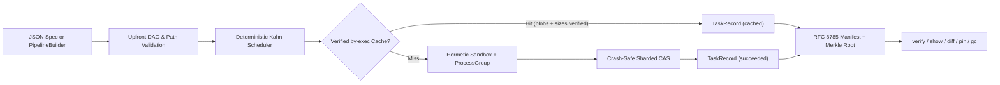

# verirun

`verirun` is a deterministic task runner and content-addressed build and evaluation store written in Rust, paired with a zero-dependency typed Python 3.10+ SDK.

You describe a directed acyclic graph (DAG) of tasks as strict JSON data or through `verirun.PipelineBuilder`. Before spawning a single subprocess, `verirun` validates the entire graph, runs each task inside an isolated working directory with a scrubbed environment, streams every input, output artifact, and standard stream into a crash-safe SHA-256 content-addressed store, and seals the run with an RFC 8785 (JCS) canonical manifest and domain-separated Merkle root.

## Core guarantees

- **Upfront validation before side effects.** Cycles, unknown dependencies, duplicate task IDs, colliding outputs, reserved environment keys (`PATH`, `HOME`, `TMPDIR`, `TZ`, `LC_ALL`, `SOURCE_DATE_EPOCH`), out-of-range integers above `2^53 - 1`, and unsafe paths fail with exit code `3` before opening the store or work root (`INV-LAT-4`).
- **Hermetic execution and process-tree containment.** Tasks run with a cleared environment holding only declared `env` pairs plus `LC_ALL=C`, `TZ=UTC`, `SOURCE_DATE_EPOCH=0`, and a private sandbox `TMPDIR`. Timeouts terminate the entire Unix process group or Windows Job Object (`INV-RUN-4`).
- **Race-free, crash-safe content store.** Declared outputs are collected component by component relative to open directory handles (`openat` with `O_NOFOLLOW` on Unix, `NtCreateFile` reparse-point rejection on Windows). Every stored blob lands via temporary file write, `fsync`, atomic rename, and directory sync in bounded `64 KiB` chunks (`INV-CAS-1`, `INV-CAS-8`).
- **Verified `by-exec` caching.** Before reusing a cached task record, `verirun` verifies that every referenced artifact and stream blob exists in the store and matches its recorded SHA-256 digest and byte count (`INV-RUN-7`).
- **End-to-end tamper conviction.** `verirun verify` checks the manifest digest, canonical RFC 8785 byte identity, Merkle root, and every referenced blob, exiting with code `2` on any corrupted byte or size mismatch (`INV-MAN-3`, `INV-MAN-4`, `INV-MAN-5`).

## Workspace architecture

| Crate | Role | External runtime dependencies |
| --- | --- | --- |
| `verirun-core` | Strict JSON parser, RFC 8785 canonical encoder, domain-separated digest framing, DAG validator, and Merkle manifest model | None (`std` only, `#![forbid(unsafe_code)]`) |
| `verirun-platform` | OS FFI boundary for process groups / Job Objects, no-follow handle-relative traversal, and atomic `rename_replace` | `libc` (Unix), `windows-sys` (Windows) |
| `verirun-store` | Sharded filesystem CAS, hermetic subprocess runner, parallel scheduler, `by-exec` cache, and garbage collector | `sha2` |
| `verirun-cli` | `verirun` binary and high-level pipeline library with total `--json` parity and total exit codes (`0`, `1`, `2`, `3`) | `clap`, `serde_json` |

## Where to start

| Goal | Chapter |
| --- | --- |
| Install `verirun` and run your first Python or CLI pipeline in two minutes | [Quickstart](./quickstart.md) |
| Follow a CLI walkthrough covering cold run, warm cache, diff, pin, and GC | [Step-by-step tutorial](docs/TUTORIAL.md) |
| Look up CLI flags, `--json` schemas, exit codes, and Python SDK types | [CLI and Python SDK](./cli-and-python.md) |
| Inspect the wire formats, store state machine, and Merkle framing rules | [Architecture](docs/ARCHITECTURE.md) |
| Audit every formal invariant (`INV-*`) and its enforcing test or fault oracle | [Invariants and traceability](docs/INVARIANTS.md) |
| Decide when to use `verirun` vs `make`, `Bazel`, containers, or custom scripts | [How verirun compares](docs/COMPARISON.md) |
| Check common questions about warm-cache manifests, number bounds, and GC | [FAQ](docs/FAQ.md) |
